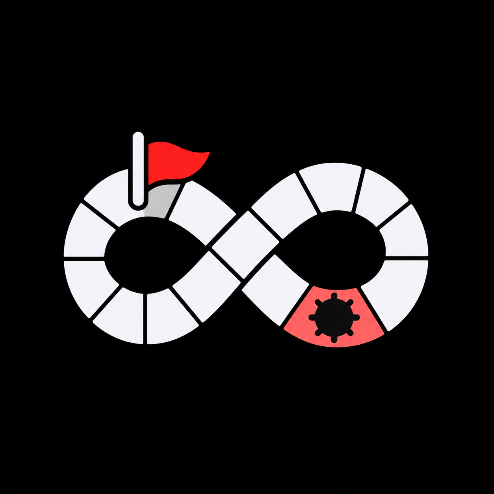
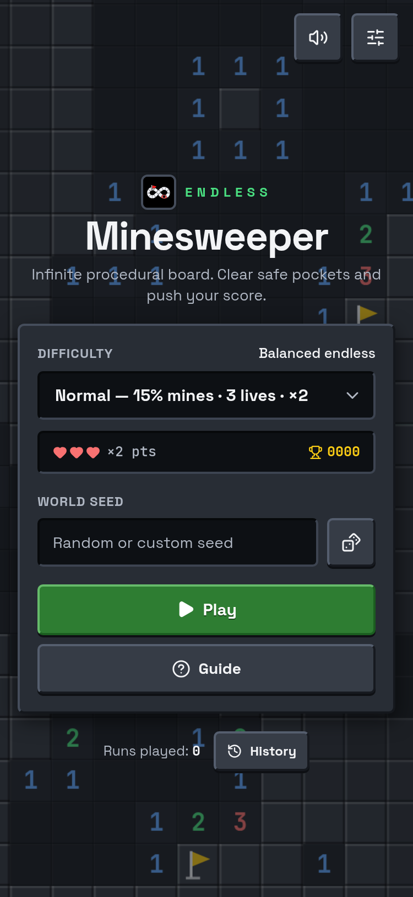
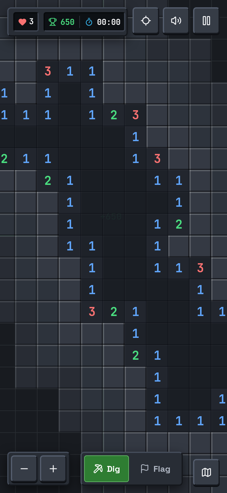
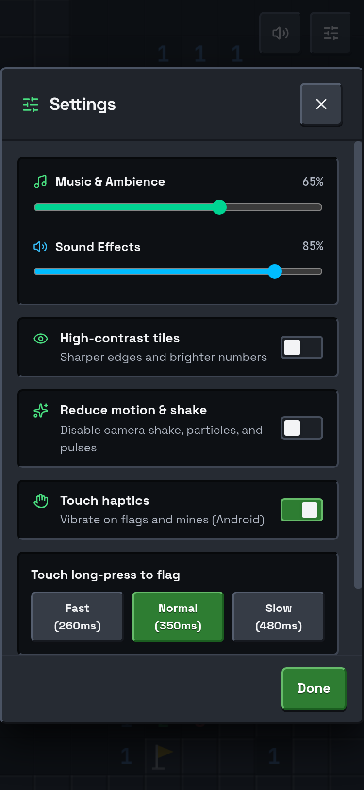

<p align="center">
  
</p>

<h1 align="center">Endless Minesweeper</h1>

<p align="center">
  An infinite, procedurally generated minesweeper board with no edges.
</p>

Explore as far as you want in any direction. Your first click always clears a safe 3x3 pocket, and the board expands on demand as you pan and dig.

## Screenshots

<table>
  <tr>
    <td align="center">
      
      <br />
      <sub>Start menu</sub>
    </td>
    <td align="center">
      
      <br />
      <sub>Gameplay</sub>
    </td>
    <td align="center">
      
      <br />
      <sub>Settings</sub>
    </td>
  </tr>
</table>

## Difficulties

| Difficulty | Mine density | Lives | Score multiplier |
| --- | --- | --- | --- |
| Easy | 11% | 5 | 1x |
| Normal | 15% | 3 | 2x |
| Hard | 19% | 2 | 3x |
| Insane | 24% | 1 | 5x |

Higher numbered tiles and higher difficulties award more points.

## Controls

### Touch

- **Tap**: Dig a hidden tile, or chord a revealed number whose surrounding flags match its value.
- **Long-press**: Place or remove a flag (hold duration can be tuned in Settings).
- **Dig / Flag switch**: Toggle one-tap flagging from the bottom bar.
- **Drag and pinch**: Pan across the board and zoom in or out.

### Mouse and keyboard

- **Left click / `Enter`**: Dig a hidden tile or chord a satisfied number.
- **Right click / `F`**: Place or remove a flag.
- **Drag / `W` `A` `S` `D` / Arrow keys**: Pan the camera or move the tile cursor. Hold `Shift` to pan faster.
- **Scroll wheel / `+` `-`**: Zoom in or out.
- **`C`**: Center the camera on the origin.
- **`Esc` / `P`**: Pause or open settings.

### Gamepad

- **D-pad**: Move the tile cursor.
- **`A` / `X`**: Dig or flag the focused tile.

## Features

- **World seeds**: Leave the seed blank for a random board, or enter a custom seed to replay and share the exact same layout.
- **Local history and high scores**: Best scores per difficulty and past run records are saved locally in IndexedDB on your device.
- **Minimap**: Track explored regions and jump back toward active areas.
- **Audio and accessibility**: Separate music and sound effect sliders, high-contrast tile mode, reduced motion toggle, and touch haptics.

## Development

Built with React, TypeScript, Vite, Tailwind CSS, HTML5 Canvas, Web Audio API, and IndexedDB.

```bash
npm install
npm run dev    # start local dev server
npm test       # run core tests
npm run build  # build production bundle into dist/
```

## License

Licensed under the [GNU General Public License v3.0](LICENSE).

<details>
<summary><sub>Credits</sub></summary>

- <sub>Game logo: AI-generated with GPT.</sub>
- <sub>Code: LLM-generated with Gemini 4 Hydrogen.</sub>

</details>
